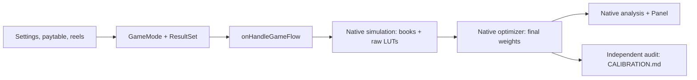

# ButchEm

5x5 cluster pays, no tumbling or padding, 10 default free spins, and a 10,000x
cap across the complete paid round. Coordinates are `[x, y]`, with `[0, 0]`
at the top-left visible cell; the board is column-major `board[x][y]`.

**Current model:** 96% RTP in every mode, additive participating wild
multipliers, and base bonus triggers at 1/300 regular, 1/3000 super, and
1/50000 hidden. Explicit below-cost targets match the panel's **Payout < Bet Hit
Rate** field; cost recovery is the complementary probability.
[CALIBRATION.md](CALIBRATION.md) records the last audited weighted-book results.

## Run it

From the repository root, install with `pnpm install`, then:

```powershell
pnpm --filter butch-em build
pnpm --filter butch-em run audit
pnpm --filter butch-em payouts
pnpm --filter butch-em panel
```

Open **http://localhost:7770** and select **ButchEm**. The dedicated
[panel guide](PANEL.md) explains the simulation, statistics, book explorer,
and reel editor.

You can also `cd examples/ButchEm` and run `pnpm build`, `pnpm run audit`,
and `pnpm panel`, just like the other examples. Use the repository's Node
requirement (>=23.8) and pnpm. The compressed books require Zstandard support.

`build` runs Slot Engine's simulation, optimizer, and analysis, in that order.
It produces **25,000 accepted rounds per mode** by default. Each count can be
changed independently in `SIM_RUNS` in `src/settings.ts`:

```ts
export const SIM_RUNS = {
  base: 25_000,
  extraChance: 25_000,
  extraChance2: 25_000,
  featureSpin: 25_000,
  bonusFeature: 25_000,
  superBonusFeature: 25_000,
  hiddenBonusFeature: 25_000,
}
```

For a quick development run, `BUTCH_SIM_RUNS` still overrides every mode:

```powershell
$env:BUTCH_SIM_RUNS = "1000"
pnpm --filter butch-em build
Remove-Item Env:BUTCH_SIM_RUNS
```

An individual mode can instead be overridden without changing the others:

```powershell
$env:BUTCH_SIM_RUNS_BASE = "50000"
$env:BUTCH_SIM_RUNS_FEATURE_SPIN = "10000"
pnpm --filter butch-em build
Remove-Item Env:BUTCH_SIM_RUNS_BASE
Remove-Item Env:BUTCH_SIM_RUNS_FEATURE_SPIN
```

Available suffixes are `BASE`, `EXTRA_CHANCE`, `EXTRA_CHANCE_2`,
`FEATURE_SPIN`, `BONUS_FEATURE`, `SUPER_BONUS_FEATURE`, and
`HIDDEN_BONUS_FEATURE`. Per-mode environment values take precedence over the
global override, which takes precedence over `SIM_RUNS`.

Simulation workers now default to the CPU's available parallelism, capped at
24 (and at least 2). On a 24-thread machine this matches VikingQuest and
SmokeysStash. To leave more CPU available for other work:

```powershell
$env:BUTCH_SIM_CONCURRENCY = "12"
pnpm --filter butch-em simulate
Remove-Item Env:BUTCH_SIM_CONCURRENCY
```

[PERFORMANCE.md](PERFORMANCE.md) records the current profiling results and the
repeatable `pnpm --filter butch-em benchmark` diagnostic. Cached movement
geometry, faster collision/landing checks, and fewer board allocations measured
**1.9-2.2x faster generation** across all seven modes, with identical seeded
books and retry counts. The benchmark excludes disk output and optimization.

Smaller runs provide less variety and may not support every optimization target
after you edit the math. Increase the sample count if a target lacks candidates.

| Command (after `pnpm --filter butch-em`) | Purpose                                                           |
| ---------------------------------------- | ----------------------------------------------------------------- |
| `build`                                  | Native simulation, optimization, and analysis                     |
| `simulate`                               | Generate new candidates using native result sets                  |
| `optimize`                               | Reweight existing candidates, then refresh native analysis        |
| `analyze`                                | Refresh native statistics without generating or reweighting books |
| `targets`                                | Print configured targets and the most recent independent audit    |
| `payouts -- [mode] [--raw]`              | Write a detailed optimized payout-range table and CSV             |
| `run audit`                              | Verify generated books/LUTs and write `CALIBRATION.md`            |
| `panel`                                  | Start the GUI for this game                                       |
| `typecheck` / `test`                     | Check TypeScript / run mechanics and native-flow tests            |

The old separate `calibrate` command and independent round generator have
been removed. There is now one production flow: the Slot Engine game hook.

## How the files fit together



| File                                                           | What to change or read here                                                    |
| -------------------------------------------------------------- | ------------------------------------------------------------------------------ |
| [index.ts](index.ts)                                           | Symbols, modes, game configuration, and native task configuration              |
| [src/settings.ts](src/settings.ts)                             | Mode costs, bonus frequencies, minimum/average targets, and upgrade rules      |
| [src/paytable.ts](src/paytable.ts)                             | Cluster payouts in multiples of the base stake                                 |
| [src/reels.ts](src/reels.ts)                                   | Generated reel strips and reel selection weights                               |
| [src/resultSets.ts](src/resultSets.ts)                         | Candidate quotas, payout ranges, and acceptance conditions                     |
| [src/math.ts](src/math.ts)                                     | Probability/RTP budgets and native optimizer targets                           |
| [src/onHandleGameFlow.ts](src/onHandleGameFlow.ts)             | Base reveal, bonus entry, free-spin loop, movement, and events                 |
| [src/evaluations.ts](src/evaluations.ts)                       | Native cluster evaluation plus ButchEm's wild multiplier and cap               |
| [src/events.ts](src/events.ts)                                 | Shared event names, reveal/win serializers, and win levels                     |
| [src/feature.ts](src/feature.ts), [src/wilds.ts](src/wilds.ts) | Persistent upgrades, roaming, and 2x2 geometry                                 |
| [src/clusters.ts](src/clusters.ts)                             | Independent reference evaluator for tests/audit, plus the cent-safe cap helper |
| [scripts/audit.ts](scripts/audit.ts)                           | Independent checks of the engine's generated artifacts                         |
| [panel.ts](panel.ts)                                           | Import this game and start the matching Slot Engine panel                      |

The flow uses `ctx.services.board` to choose real reels and draw random stops,
then overlays the roaming wilds. Scatters live on the reel strips: trigger
spins force 3/4/5 scatter reel stops, organic base spins show at most 2
near-miss scatters, and no reel ever shows more than one. `ClusterWinType`
finds the connected wins;
ButchEm applies wild multipliers and the remaining round cap.
`ctx.services.wallet.addSpinWin/confirmSpinWin` settles each reveal.
`ctx.services.game.awardFreespins` and the engine state track the bonus.
Events and searchable tags go through `ctx.services.data`.

Reel profiles `standard`, `dense`, `tail`, and `maxwin` provide candidate
coverage. Dense profiles emphasize the symbol at the end of their ID, for
example `bonus_tail_H1`. They are actual `GeneratedReelSet` strips, drawn by
the engine. The generated CSVs in `__build__` can be edited in the panel.

Forced max-win candidates use `base_maxwin_mixed_<symbol>` and
`bonus_maxwin_mixed_<symbol>` strips with a gentler focus concentration. Each
source board is drawn from real reel stops and retried until it has at least
three paying symbol types and at most 15 of any one paying symbol. Roaming
wilds still complete and multiply clusters normally, and the native result set
still requires the exact 10,000x round cap. The fresh strip IDs avoid reusing the
old saved monochrome max-win CSVs. Rebuild to generate new books and optimizer
weights; existing books retain their previous reveals.

Result-set **quotas are sampling allocations**, not player probabilities.
The optimizer assigns final LUT weights to meet the RTP, hit-rate, and bonus
frequency targets. Bonus minimums are acceptance conditions; payouts are never
topped up. The hook forces exactly 3/4/5 scatter reel stops for the selected
bonus tier — bought bonuses included, so every bonus is visibly triggered from
a real spin — while trigger frequencies are determined by the weighted result
sets.

This follows the current [Core documentation](https://slot-engine.dev/docs/core),
[native simulation workflow](https://slot-engine.dev/docs/core/game-tasks/simulation),
and [optimization workflow](https://slot-engine.dev/docs/core/game-tasks/optimization).
ButchEm pins Core 0.3.2 and Panel 0.2.2; older examples in this checkout use
older APIs and can keep their own dependencies.

## Mechanics

Clusters connect horizontally/vertically and pay at sizes 5, 6, 7, 8, 9, 10,
11, 12, 13, 14, and 15-25. The last group shares one pay. L1/L2 have identical
pays, L3/L4 have identical pays, and H4 > all lows, H3 > H4, H2 > H3, H1 > H2
for every size. The paytable is in `src/paytable.ts`.

Payouts below are base-stake multiples, before wild multipliers. All steps
use at most one decimal place and reuse common values across symbols.

| Symbol  |   5 |   6 |   7 |   8 |   9 |  10 |  11 |  12 |  13 |  14 | 15-25 |
| ------- | --: | --: | --: | --: | --: | --: | --: | --: | --: | --: | ----: |
| L3 / L4 | 0.2 | 0.3 | 0.4 | 0.6 | 0.8 | 1.5 |   3 |   5 |   8 |  12 |    20 |
| L1 / L2 | 0.4 | 0.5 | 0.6 | 0.8 | 1.5 |   3 |   5 |  10 |  15 |  25 |    40 |
| H4      | 0.5 | 0.8 | 1.5 |   3 |   5 |  10 |  15 |  20 |  25 |  35 |    50 |
| H3      | 0.8 |   1 |   2 |   4 |   8 |  15 |  20 |  30 |  40 |  50 |    80 |
| H2      |   1 | 1.5 |   3 |   5 |  10 |  20 |  30 |  40 |  50 |  70 |   100 |
| H1      | 1.5 |   2 |   4 |   8 |  15 |  30 |  40 |  60 |  80 | 120 |   200 |

Wilds have no independent payout. Each matching symbol's connected components
are evaluated separately, allowing one wild to participate in multiple
clusters. A wild-only board does not pay.

| Real H symbols crossed during movement | Unlock                           |
| -------------------------------------- | -------------------------------- |
| H1, 5 collected                        | All wilds become 2x2             |
| H2, 5 collected                        | A second persistent roaming wild |
| H3, 5 collected                        | 20x on every wild                |
| H4, 5 collected                        | 5x on every wild                 |

H3 and H4 together give each wild 25x, without an extra base 1x. Two
participating 25x wilds give a cluster **50x**. Each 2x2 wild counts once,
regardless of how many of its four cells join the cluster. Unupgraded 1x
substitutes do not boost the symbol payout.

Wild cells still count toward the five-cell minimum for a paying cluster.
Collection is independent of those wins: every real H cell crossed during
post-spin movement contributes to its symbol's shared persistent meter.
Five H1/H2/H3/H4 symbols unlock the corresponding upgrade once per feature.
Meters reset when a feature starts. Already unlocked H symbols are still
reported as pickups, but their meters stop advancing.

Normal bonuses begin with no upgrades, super bonuses with one, and hidden
bonuses with two. featureSpin begins with 1/2/3/4 distinct random upgrades at
70%/15%/10%/5%. The count is part of its optimized result-set probability, so
payout rejection and final book weighting cannot distort that distribution. Both bought and triggered versions use the same feature
mechanics. There is one guaranteed roaming wild initially; an initial H2
upgrade immediately adds the second.

Before each feature reveal, every truck repositions from the preceding
movement or upgrade anchor along a random path of **1-8 unit cell moves**.
This phase never collects symbols or advances meters. Only its final footprint
is wild for the new spin's payout evaluation. After a feature spin settles,
every truck takes another random path of **1-8 unit cell moves** if another
feature spin will follow, including after losing spins. The actual final free
spin, single-spin featureSpin, and max-win finish skip post-spin collection and
its upgrades. A last scheduled spin that retriggers still collects, since the
newly awarded spins can use those upgrades. A route has one straight leg or two perpendicular legs,
with at most one turn and no reversal. The eight-cell maximum is per truck,
per movement phase per spin; it is distance travelled, not a collection limit.
A 1x1 truck can reach the opposite corner in four horizontal and four vertical
moves when the route is clear. The movement event structure is unchanged;
`steps` can now contain up to **9 entries**, including the starting anchor.
Regenerate and re-optimize books to apply the longer paths to generated results.
Both phases use the same movement geometry and syntax. Collection routes are
chosen randomly, independently of symbols and winning clusters. Collection
movement may finish over H1-H4 symbols, including in any cell of a 2x2 footprint;
H symbols under the final step collect just like those under intermediate steps.

The 2x2 anchor is its bottom-left cell, occupying
`[x,y], [x+1,y], [x,y-1], [x+1,y-1]`. Both phases record all four underlying cells at every unit step. During
collection, every moved-to footprint collects all H symbols there, including
mixed H types.
Overlapping footprints and paths from different trucks credit each real
cell at most once per spin. The initial anchor is recorded without a pickup;
collection begins at the first moved-to footprint. Movement continues for
the entire chosen route after a meter reaches five, so meters can exceed
five and several upgrades can unlock on one spin.

In both phases, trucks play in `roamingWildIndex` order. Every path avoids the
full stationary footprints of the other trucks, including at intermediate unit
steps.
Only the reveal footprints are wild for payout evaluation; movement neither
re-evaluates wins nor leaves a paying trail. A step may cross or finish over
a scatter after its retrigger has been counted; scatters never collect or
change. Repositioning final footprints avoid **all H1-H4 symbols and scatters**
on the new board, including every cell of a 2x2 truck. The truck cannot conceal
an animal when it lands for the reveal.
Starting and intermediate footprints may pass over H symbols and scatters without collecting; their final stops
leave every scatter visible for the reveal and retrigger count. If no joint
repositioning route can find endpoints free of H symbols and scatters, real strip
stops are redrawn before any movement is committed. There is no additional
redraw or reveal-route check for an H-free collection destination.

The reveal `board` contains the real source symbols without a roaming or
expanded natural-wild overlay. H symbols on the source board are preserved; landing eligibility is checked
before the reveal instead of repainting animals beneath a truck. Every movement step records original
symbol IDs and exact coordinates so the frontend can apply alternate artwork
to collected animals. The engine does not substitute L symbols for them.

All movement on a spin uses the reveal's current size. Unlocks are committed
after every truck finishes and emitted separately as `upgradeUnlocked`.
Size changes can re-anchor trucks to keep their full footprints on board and
clear of each other; newly spawned wilds inherit the active upgrades. Final
movement anchors, adjusted by any upgrade event, become the next repositioning
phase's starting anchors.

Implementation choices retained from the initial draft: 3/4/5 scatters trigger
normal/super/hidden; each scatter landing during free spins awards +1 extra
spin; featureSpin is one spin with its weighted starting upgrades and does not
trigger a bonus; natural wilds appear in base, while bonus wilds
come from the guaranteed roaming wild and H2.

Non-triggering spins in base, extraChance, and extraChance2 keep 85% of
otherwise-valid boards containing one or two S symbols, redrawing real reel
stops for the remainder. Zero-scatter boards pass unchanged. This modestly
reduces near-misses without changing forced triggers or free-spin retriggers;
the final reduction depends on the mode's optimized book weights. Tune
`NON_TRIGGER_SCATTER_ACCEPTANCE` in `src/settings.ts` and rebuild the books to
apply it; existing reel CSVs can be kept.

## Math targets

All seven modes target **96% RTP**. Simulation quotas generate candidate books;
published lookup weights determine player probabilities. The gameplay rules,
events, reel strips, and 10,000x round cap are unchanged by this calibration.

| Mode | Cost | Nonzero hit rate | Mean payout | Below cost | Cost recovery |
| ---- | ---: | ---------------: | ----------: | ---------: | ------------: |
| base | 1x | 20% | 0.96x | 89% | 11% |
| extraChance | 1.5x | 25% | 1.44x | 90% | 10% |
| extraChance2 | 3x | 25% | 2.88x | 90% | 10% |
| featureSpin | 50x | 80% | 48x | 80% | 20% |
| bonusFeature | 100x | 100% | 96x | 75% | 25% |
| superBonusFeature | 300x | 100% | 288x | 80% | 20% |
| hiddenBonusFeature | 1000x | 100% | 960x | 80% | 20% |

Nonzero hits include triggering rounds. The panel's **Payout < Bet Hit Rate**
includes zero pays and partial returns; cost recovery means payout at least the
mode cost. Neither these hit rates nor bonus-entry frequencies needed to change
to fund the final bonus alignment.

### Entry frequencies

| Mode | Normal entry | Super entry | Hidden entry |
| ---- | -----------: | ----------: | -----------: |
| base | 1 / 300 | 1 / 3,000 | 1 / 50,000 |
| extraChance | 1 / 150 | 1 / 1,500 | 1 / 25,000 |
| extraChance2 | 1 / 60 | 1 / 600 | 1 / 10,000 |

Extra Chance keeps exactly 2x the base entry probabilities, and Extra Chance 2
keeps 5x. Rare tail and max-win outcomes are included within each tier's entry
probability. A buy guarantees entry into its purchased tier.

### Shared conditional bonus distributions

All payouts here are **base-bet multiples**. A bonus total includes its triggering
spin and every free spin, matching `freeSpinEnd`. The guaranteed minimum also
uses that complete round total; the native segmented LUT's free-spin-only
column excludes the triggering win and must not be used as the guarantee.

Base means deliberately match the corresponding buy cost multiplied by 96% RTP.
Extra Chance means remain slightly lower, as requested, with the same payout-band
probabilities. Their lower means come from smaller averages inside those bands.

| Entry route | Normal mean | Super mean | Hidden mean |
| ----------- | ----------: | ---------: | ----------: |
| base / corresponding buy | 96x | 288x | 960x |
| extraChance | 92x | 280x | 940x |
| extraChance2 | 90x | 276x | 930x |

| Entry route | Normal median | Super median | Hidden median |
| ----------- | ------------: | -----------: | ------------: |
| corresponding buy | 74.80x | 256.50x | 900.00x |
| base | 74.90x | 256.60x | 900.40x |
| extraChance | 72.60x | 254.10x | 885.20x |
| extraChance2 | 70.70x | 253.40x | 875.10x |

These medians are measured on the current 25,000-book pools. Integer lookup
rounding and gaps between sampled payouts can put the reported median slightly
above its configured cut.

Minimum round awards remain **16/87/800x** for base and buys, and **12/65/800x**
for Extra Chance modes. No award is topped up or modified.

Every reporting-band probability is now shared across all four entry routes
for its tier. These are **conditional odds after entering that bonus**:

| Tier / payout band | Probability | One in bonus entries |
| ------------------ | ----------: | -------------------: |
| Normal: 200–<250x | 0.8000% | 125 |
| Normal: 250–<500x | 2.0000% | 50 |
| Normal: 500–<1000x | 0.2300% | 434.78 |
| Normal: 1000–<2000x | 0.0200% | 5,000 |
| Normal: 2000–<3000x | 0.0328% | 3,048.78 |
| Normal: 3000–<5000x | 0.0022% | 45,454.55 |
| Super: 500–<1000x | 4.3000% | 23.26 |
| Super: 1000–<2000x | 0.6500% | 153.85 |
| Super: 1000x+ | 0.7740% | 129.20 |
| Hidden: 1000x+ | 20.0000% | 5 |
| Hidden: 2000–<3000x | 0.6000% | 166.67 |
| Hidden: 3000–<5000x | 0.5200% | 192.31 |

Normal 250–500x awards previously occurred around 1/401 in base, 1/549 in
Extra Chance, 1/1017 in Extra Chance 2, and 1/52 in the buy. All are now 1/50.
For example, that means one such base outcome per approximately **15,000 base
plays** at a 1/300 bonus-entry rate, versus one per **50 buys**. Comparing
unconditional mode-play odds would conflate entry frequency with bonus quality.

`shapeTierBuckets` in `src/math.ts` groups every tier's existing criteria into
one shared profile, with explicit splits at reporting boundaries including
250x and 3000x. Matching only a median or a broad 200–500x budget left large
within-band differences in earlier calibrations. The new targets pin each
reporting band's probability and mean and preserve median cuts.

Exact 10,000x odds now also match the corresponding buy **per bonus entry**:

| Tier | Exact-max probability | Conditional one in |
| ---- | --------------------: | -----------------: |
| Normal | 0.002% | 50,000 |
| Super | 0.006% | 16,666.67 |
| Hidden | 0.020% | 5,000 |

Normal triggered exact-max odds were previously 1/20,000; super triggered odds
were also 1/20,000. These changed to match the buys. Feature Spin retains its
separate 1/100,000 exact-max probability and 70/15/10/5 upgrade-count mix.

### Funding, volatility, and validation

Stronger bonuses are funded by transferring some ordinary upper-band wins into
the small 2–5x / 3–5x recovery bands. All probability and EV budgets are checked.
Conditional ordinary winning-round averages change from **2.959 to 2.673x** in
base, **3.032 to 2.483x** in Extra Chance, and **5.040 to 3.571x** in Extra Chance 2.

Compared with the preceding calibration, SD / mode cost changes from
**12.573 to 12.781** in base (+1.7%), **10.601 to 10.982** in Extra Chance (+3.6%),
and **8.249 to 8.517** in Extra Chance 2 (+3.3%). Normal/super buy volatility
decreases slightly; hidden buys and Feature Spin are unchanged. The medium
volatility design intent remains; there is no universal numerical threshold
that certifies that label.

Feature Spin retains its four-upgrade 50–100x band average of 75x and the
offsetting 100–250x average of 111.53x. Its weights and all gameplay events are
unchanged.

Validation includes 126 game tests, TypeScript checking, 2,220 fresh accepted
simulations across all 74 bonus-bearing result sets (37,167 candidate attempts),
and an independent audit of all 175,000 compressed books. The installed runtime
is Node 22.21.0; the repository's normal Node >=23.8 requirement is unchanged.

Reproduce the complete checks:

```powershell
pnpm --filter butch-em optimize
pnpm --filter butch-em compare-bonuses --check
pnpm --filter butch-em run audit
pnpm analyze --build-dir examples/ButchEm/__build__
```

The comparison command verifies target means, minimums, entry rates, and every
conditional reporting-band probability against the corresponding buy. It writes
`__build__/bonus-comparison.json` and
[`ButchEm - bonus comparison.txt`](../../Math%20Mode%20Analysis/ButchEm%20-%20bonus%20comparison.txt).
[CALIBRATION.md](CALIBRATION.md) records the current audited results.

## Events

Event names are stored in `type`, inside Slot Engine's `{ index, type, data }`
envelope. The shared names and payload conventions match
[CabinFever](../cabin_fever/src/onHandleGameFlow.ts),
[clusterGameOG](../clusterGameOG/src/onHandleGameFlow.ts), and
[SmokeysStash](../SmokeysStash/src/onHandleGameFlow.ts).
[src/events.ts](src/events.ts) defines the contract and serializers.

| Event                    | Payload and meaning                                                                              |
| ------------------------ | ------------------------------------------------------------------------------------------------ |
| `reveal`                 | `board`, `anticipation`, plus ButchEm feature data                                               |
| `winInfo`                | `{ totalWin, wins }`; one event contains every paying cluster on this reveal                     |
| `setWin`                 | `{ amount, winLevel }`; this reveal's award                                                      |
| `setTotalWin`            | `{ amount }`; base-spin award, or the accumulated feature total during free spins                |
| `freeSpinTrigger`        | `{ totalFs, positions, tier }`; positions are real scatter `{ reel, row }` objects, for buys too |
| `updateFreeSpin`         | `{ amount, total }`; one-based current spin number and total awarded spins                       |
| `addAdditionalFreeSpins` | `{ additionalFs, remainingFs, totalFs, positions }`; +1 spin per scatter landed during the bonus |
| `freeSpinEnd`            | `{ amount, winLevel }`; feature total, including the triggering spin's own award                 |
| `finalWin`               | `{ amount }`; complete round total, emitted only when it is above zero                           |

On a winning reveal, the sequence is **reveal → winInfo → setWin → setTotalWin**,
then movement and upgrades. Losing feature reveals still emit movement. Losing reveals omit all three win events, and a
zero-win round omits `finalWin`, like SmokeysStash. A bonus starts with a real
triggering reveal, then `freeSpinTrigger → featureStart → updateFreeSpin →
reveal`. Scatters landing during free spins emit `addAdditionalFreeSpins`.
It ends with `freeSpinEnd → finalWin`. There is no tumble event.
Max-win presentation uses `winLevel: 7` at the 10,000x cap, rather than a
separate `maxWin` event. Other win levels use ButchEm's own
25x/50x/100x/200x/350x thresholds.

Reveal symbols are objects such as `{ name: "H3" }`,
`{ name: "S", Scatter: true }`, or (only for a real, natural "W" landed on
the reel) `{ name: "W", Wild: true, multiplier: 25 }`. `board` never carries
the roaming/natural wild overlay used for win evaluation. It contains the
original drawn symbol IDs;
there is no separate `sourceBoard` field.
The board remains exactly 5x5 and column-major. `anticipation` is a five-element
0/1 array. Reveal events omit the unused `paddingPositions`, `gameType`,
`naturalWilds`, and `spinType` properties.

Each `winInfo.wins` entry matches the cluster game's format:

```json
{
  "symbol": "H3",
  "kind": 5,
  "win": 20,
  "positions": [
    { "reel": 0, "row": 0 },
    { "reel": 0, "row": 1 },
    { "reel": 0, "row": 2 },
    { "reel": 0, "row": 3 },
    { "reel": 0, "row": 4 }
  ],
  "meta": { "multiplier": 25, "winWithoutMult": 0.8 }
}
```

`win` is the actual credited award after the round cap. `winWithoutMult`
is the underlying symbol pay. All awards use base-stake multiples.

`featureStart` provides initial upgrades and wilds before the first feature
reveal. Both `featureStart.roamingWilds` and `reveal.roamingWilds` use the same
per-truck movement shape as `moveRoamingWild.data.movements`, with an additional
`multiplier` for the reveal's payout state. There is no frontend `positions`
array; all paths use `steps` with `{ reel, row, symbols }` objects.

`featureStart` supplies one initial step per truck, with `symbols: []` because
the first feature board has not been drawn. Each reveal's `roamingWilds`
contains the full repositioning path, including its starting step and every
unit move. The first step matches the preceding feature-start, collection, or
upgrade anchor. The final step supplies the wild footprint used for wins and
becomes the starting step of that spin's collection movement.

Repositioning uses `collectedSymbols: []`, `collectedCount: 0`, and
`collected: false` on every footprint cell, even when crossing an H symbol.
It does not emit a second `moveRoamingWild` event or unlock an upgrade.
Only reveal destinations must be clear of H symbols across the entire truck
footprint. Collection movement may finish over H symbols. Animate every step,
including final-step pickups marked by `symbols[].collected`.
The separate `upgradeUnlocked` event remains the same.

Exactly one `moveRoamingWild` event is emitted after each feature spin that has
a following feature spin. Terminal spins emit neither `moveRoamingWild` nor
collection-triggered `upgradeUnlocked`; their reveal still includes the normal
non-collecting roaming path. A last scheduled spin that retriggers emits
`addAdditionalFreeSpins` before movement and upgrades. Frontend
contracts must allow a final reveal/win sequence to proceed directly to
`freeSpinEnd`/`finalWin` (or round completion for a zero payout featureSpin)
without waiting for a collection event. The movement payload is unchanged:

- `movements`: one entry per truck in playback order, with
  `roamingWildIndex`, `size`, `steps`, `collectedSymbols`, and `collectedCount`.
- `steps`: the starting anchor followed by **every** moved-to cell, each using
  `{ reel, row }` coordinates. A step's `symbols` array lists the entire
  footprint as `{ reel, row, symbol, collected }`. A true `collected` flags
  the unique pickup for that H cell; repeated coverage is false.
- `collectedSymbols`: per-truck H totals, with `symbol`, `upgrade`, `count`
  (this truck's pickups), and `collected` (shared running meter after this truck).
  `collectedCount` totals this truck's unique pickups.
- Top-level `collected`: all four shared meters after movement.
  `upgrades` is the active state before new unlocks.

Frontend contract update: remove `data.required` and
`data.movements[].collectedSymbols[].required` from TypeScript types and JSON
validation schemas. Use the fixed threshold **5** for every H1-H4 upgrade meter.
Pickup counts, cumulative meters, movement steps, event names, and the separate
`upgradeUnlocked` event are unchanged. The threshold remains in the engine's
internal rules; it is no longer repeated in the event JSON. Regenerate simulation
books to remove these fields from previously generated events.

There are no `op`, `collectedMultiplier`, or `newMultiplier` fields.
The former `collect` event is replaced completely. For example:

```json
{
  "type": "moveRoamingWild",
  "data": {
    "movements": [
      {
        "roamingWildIndex": 0,
        "size": "1",
        "steps": [
          {
            "reel": 0,
            "row": 0,
            "symbols": [{ "reel": 0, "row": 0, "symbol": "L1", "collected": false }]
          },
          {
            "reel": 1,
            "row": 0,
            "symbols": [{ "reel": 1, "row": 0, "symbol": "H1", "collected": true }]
          },
          {
            "reel": 1,
            "row": 1,
            "symbols": [{ "reel": 1, "row": 1, "symbol": "H3", "collected": true }]
          }
        ],
        "collectedSymbols": [
          { "symbol": "H1", "upgrade": 1, "count": 1, "collected": 5 },
          { "symbol": "H3", "upgrade": 3, "count": 1, "collected": 2 }
        ],
        "collectedCount": 2
      }
    ],
    "collected": { "1": 5, "2": 0, "3": 2, "4": 0 },
    "upgrades": {}
  }
}
```

Here the truck moved two cells, finished over H3, and completed H1's meter.
Both H symbols collect, including H3 at the final step. A separate
`upgradeUnlocked` follows with `upgrade: 1`, updated `upgrades`, active
`multiplier` and `size`, `effectiveFromSpin`, and `roamingWildPositions`.
The next repositioning phase and reveal use that upgraded state. Event snapshots remain independent
of subsequent movement and upgrades.

The earlier `clusterWin`, `spinWin`, `bonusTriggered`,
`freeSpinsRemaining`, and `bonusEnd` names are no longer emitted.
Tests and the artifact audit enforce the shared names, payloads, and ordering.

## Generated files

The movement mechanic changes game math and book payloads. Existing books and
the previous calibration report describe the old mechanic. Rebuild simulation
books, re-optimize, and audit before publishing this version.

`__build__/publish_files/` contains the native compressed books, optimized
lookup tables, and publication manifest. The rest of `__build__/` contains
reel CSVs, uncompressed books, chunk/book/LUT indices, tags, frontend config,
and native statistics used by the panel. Keep these files when exploring
books in the GUI; the publish folder alone does not contain the panel indices.

The audit writes `__build__/math-report.json` and [CALIBRATION.md](CALIBRATION.md),
including RTP, nonzero hits, measured break-even, tier frequencies and bonus
percentiles, payout-band contributions, standard deviation, starting-upgrade
probabilities, and lookup hashes. Re-run the audit after changing generated
books or weights; it fails if the configured targets no longer match.

Upgrade identities are chosen uniformly without replacement. featureSpin's
upgrade count is encoded in its result-set criteria at 70%/15%/10%/5%. The
audit checks the final weighted count probabilities and reports individual
upgrade combinations.

Generated files and `.panel-config.json` are ignored by Git. Existing generated
reel CSVs are reused so panel edits survive a simulation. If you change the
generator settings in `src/reels.ts`, remove the corresponding generated reel
CSV before rebuilding; removing it also discards edits to that strip.
